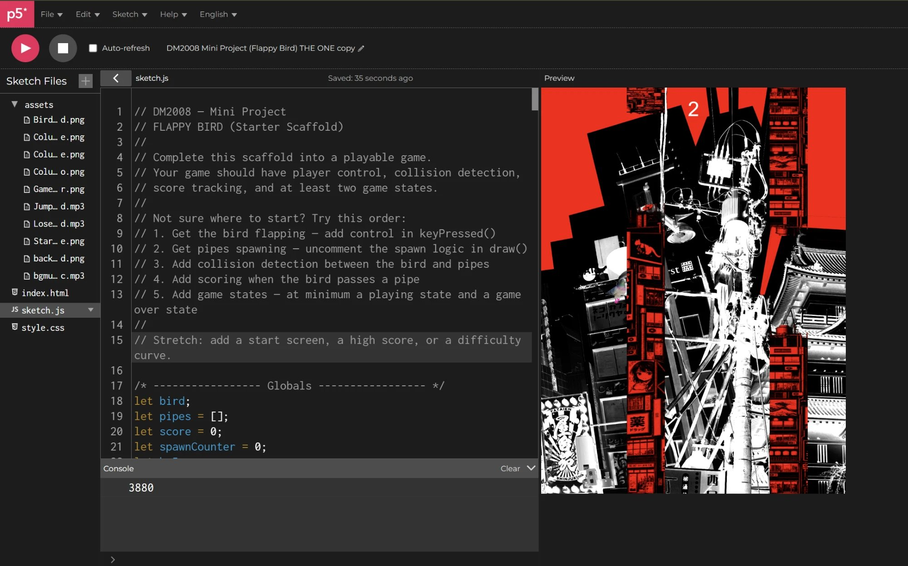

# DM2008 — Tan Zhiheng Isaac

**Course:** DM2008: Programming for Interaction  
**Academic Year:** AY2627 Semester 1  
**Nanyang Technological University, Singapore**

---

## About This Repo

This is my personal mono-repo for DM2008. It contains all my work across the semester — weekly activities, projects, and the final capstone — committed and documented progressively throughout the course.

---

## 📁 Contents

| Folder              | What's Inside                                    |
| ------------------- | ------------------------------------------------ |
| `01-activities/`    | Weekly in-class activities and exercises         |
| `02-mini-project/`  | Mini Project — Pong or Flappy Bird clone         |
| `03-sensor-jam/`    | Sensor Jam — Arduino to p5.js interactive sketch |
| `04-final-project/` | Final Project — end-of-semester capstone         |

### Activities

| Week | Activity |
| ---- | -------- |
| 1 | [activity_1a — Simple Creatures](01-activities/week-01/activity_1a/) · [activity_1b — Learning By Making](01-activities/week-01/activity_1b/) |
| 2 | [activity_2a — Mode Switch](01-activities/week-02/activity_2a/) · [activity_2b — Pattern Making](01-activities/week-02/activity_2b/) |
| 3 | [activity_3a — Array Sampler](01-activities/week-03/activity_3a/) · [activity_3b — One Function Wonder](01-activities/week-03/activity_3b/) · activity_3c (optional, not attempted) |
| 4 | [activity_4a — Bake a Cookie](01-activities/week-04/activity_4a/) · [activity_4b — Objects in Motion](01-activities/week-04/activity_4b/) |
| 5 | [activity_5a — Colliding Circles](01-activities/week-05/activity_5a/) |
| 8 | [activity_8a — Light It Up](01-activities/week-08/activity_8a/) · [activity_8b — Sensor Check](01-activities/week-08/activity_8b/) (with Belinda Chai Yu Xuan) |
| 9 | [activity_9a — Mapping Sensors](01-activities/week-09/activity_9a/) (with Belinda Chai Yu Xuan) |
| 10 | activity_10 (optional, not attempted) |

### Projects

- [**02-mini-project** — Jumpy Bird](02-mini-project/) (with Belinda Chai Yu Xuan)
- [**03-sensor-jam** — Sensor-to-Screen](03-sensor-jam/) (with Belinda Chai Yu Xuan)
- [**04-final-project** — Chatter Pasture](04-final-project/) (with Belinda Chai Yu Xuan)

---

## 🖼️ Project Highlights

**Jumpy Bird** — our Flappy Bird clone with a red, black and white Tokyo look, spinning bird and custom sound effects.

**Chatter Pasture** — draw your own creature, give it googly eyes, and release it into a shared live farm powered by Firebase.

---

_For teaching and learning purposes only. All work © Tan Zhiheng Isaac. Collaborative work (Activities 8–9, Mini Project, Sensor Jam and Final Project) © Tan Zhiheng Isaac and Belinda Chai Yu Xuan._
